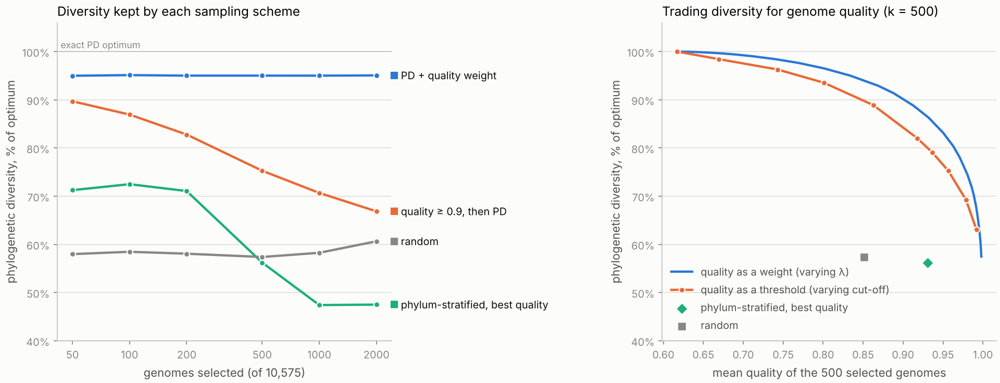

# pdpick

**Pick the *k* genomes that span a tree, without picking the worst ones.**

Choosing a few hundred representatives from tens of thousands of genomes is a
routine first step in phylogenomics. Maximising phylogenetic diversity (PD) is
the principled way to do it, and the greedy algorithm is provably optimal. It
also has a habit: the longest branches belong disproportionately to incomplete,
contaminated or fast-evolving genomes, so the "most diverse" set is enriched
for the genomes one least wants to build on.

`pdpick` keeps the exact optimisation and lets per-genome quality enter the
objective, so that diversity decides *which clades* are represented and quality
decides *which genome* represents them.



*10,575-genome reference phylogeny (Zhu et al. 2019). Left: PD retained,
relative to the exact optimum; the blue line sits at 95% because that is the
budget it was given. Right: at k = 500, treating quality as a weight keeps more
diversity at every level of mean quality than discarding genomes below a
threshold. Details in [Benchmark](#benchmark).*

## Install

```bash
git clone https://github.com/surajitishere/pdpick && cd pdpick
pip install -e ".[dev]"
pytest
```

Python ≥ 3.10; numpy and pandas only (matplotlib for the benchmark figure).

## Use

```bash
# the 40 most diverse genomes
pdpick select --tree examples/toy/tree.nwk -k 40 --out picks.tsv

# give up at most 5% of that diversity for better genomes; keep two fixed
pdpick select --tree examples/toy/tree.nwk -k 40 \
    --weights examples/toy/quality.tsv --weight-col quality --max-pd-loss 0.05 \
    --require examples/toy/required.txt --out picks.tsv
```

```text
selected 40 of 200 selectable tips (2 required)
rooted PD 30.4985 = 57.7% of all selectable tips; 95.03% of the unweighted optimum
mean weight 0.752 (unweighted optimum 0.6025, all tips 0.8506); lam = 0.4522
```

| Command | Purpose |
|---|---|
| `pdpick select` | choose `k` tips; `--full-ranking` writes every tip in selection order |
| `pdpick tradeoff` | table of PD against mean weight over a range of λ, to choose a budget |
| `pdpick evaluate` | score any selection: PD, mean and maximum distance to the nearest selected tip |

Options shared by `select` and `tradeoff`: `--weights/--weight-col` (any
non-negative per-tip score), `--min-weight` (hard threshold), `--require`,
`--exclude`, `--unrooted`.

The weight is whatever should make a genome preferable: assembly quality,
type-strain status, having phenotype data. Several criteria can be combined
into one column beforehand.

```python
from pdpick import read_newick, rank_tips, select, evaluate

tree = read_newick("tree.nwk")
ranking = rank_tips(tree)                 # every prefix is an optimal selection
ranking.top(500)
tuned = select(tree, 500, weights=quality, max_pd_loss=0.02, required=["G000005845"])
evaluate(tree, tuned.top(500), weights=quality)
```

## How it works

**Greedy is exact.** PD of a set of tips is the total length of the branches
connecting them to the root (rooted) or to each other (unrooted). Repeatedly
adding the tip that contributes the most new branch length yields a maximum-PD
set for every `k` (Steel 2005; Pardi & Goldman 2005).

**Greedy is a sort.** Give every branch to the deepest tip below it. Each tip
then owns one chain of branches running upward from itself, the chains
partition the tree, and a chain's length is the PD its tip adds when tips are
taken in decreasing order of chain length. One linear pass over the tree and
one sort produce the full ranking; the 10,575-tip tree takes 30 ms.

**Weights keep it exact.** Maximising

    PD(S) + λ · Σ w_i   over |S| = k

is plain PD maximisation on a tree whose terminal branches are lengthened by
`λ·w_i`, so the same algorithm solves it exactly for every λ. Sweeping λ traces
the supported part of the Pareto frontier between diversity and total weight.
`--max-pd-loss x` finds, by bisection, the largest λ whose solution keeps at
least `1 − x` of the unweighted optimum.

**Constraints.** Branches already covered by required tips are set to zero
before the decomposition; excluded tips are pruned. For unrooted PD the tree is
re-hung from one end of its (weighted) diameter, or from a required tip.

## Validation

`pytest` runs 101 tests in a few seconds.

- **Optimality by enumeration.** On 60 random trees of 4 to 9 tips (with
  polytomies, zero-length branches, weights, required and excluded tips, rooted
  and unrooted), every prefix of the ranking attains the best objective found
  by scoring all subsets. PD in these checks is computed from the definition by
  a separate function.
- **Structure.** Chain lengths sum to the tree length; objective gains never
  increase along the ranking; the unrooted ranking opens with the diameter;
  λ → 0 only breaks ties and λ → ∞ sorts by weight.
- **Coverage distances** agree with brute-force pairwise distances.

## Benchmark

```bash
pip install -e ".[examples]"
python examples/wol/fetch_data.py     # 2 MB, pinned commit, checksums verified
python examples/wol/benchmark.py      # ~15 s
python examples/wol/make_figure.py
```

Quality is `max(0, completeness − 5 × contamination) / 100` from the CheckM
estimates in the Web of Life metadata. Results are in
[`examples/wol/results/`](examples/wol/results).

**Plain PD maximisation picks poor genomes.** Among all 10,575 genomes the
median quality is 0.94 and 38% fall below 0.9. Among the 500 PD-optimal ones
the median is 0.60 and 79% fall below 0.9; their median genome size is 1.35 Mb
against 2.74 Mb overall.

**At k = 500:**

| Scheme | PD vs optimum | Mean quality | Phyla | Genera | Mean distance to nearest pick |
|---|---|---|---|---|---|
| PD only | 100% | 0.62 | 125 | 165 | 0.553 |
| PD + quality weight (5% budget) | 95.0% | 0.83 | 125 | 242 | 0.476 |
| Quality ≥ 0.9, then PD | 75.3% | 0.96 | 46 | 357 | 0.538 |
| Phylum-stratified, best quality | 56.2% | 0.93 | 146 | 219 | 0.521 |
| Random (mean of 50) | 57.4% | 0.85 | 63 | 254 | 0.442 |

- **Weight beats threshold.** At matched mean quality the weighted selection
  retains more PD than thresholding along the whole frontier (right panel):
  88% against 82% at a mean quality of 0.92, and 82% against 75% at 0.96. It also
  keeps far more phyla, because a threshold removes poorly sequenced lineages
  entirely while a weight still takes their best member.
- **Stratifying by phylum and taking the best genomes is no better than random
  for diversity** once `k` exceeds a few hundred (56% against 57% at k = 500;
  47% against 58% at k = 1000). The best-scoring genomes within a large phylum
  are close relatives of each other. It does cover every phylum, which PD does
  not guarantee.
- **PD is not representativeness.** Random sampling has the smallest mean
  distance from a genome to its nearest pick, because it samples where the
  genomes are dense, whereas PD seeks the sparse outskirts. If the aim is that
  every genome has a close representative, PD is the wrong objective
  (Matsen et al. 2013); `pdpick evaluate` reports both so the choice is explicit.

## Limits

- Exactness is for the stated objective on the given tree. Errors in the tree,
  and long branches that are artefacts, are optimised as faithfully as real
  signal. The weight only helps where the artefact correlates with it.
- CheckM completeness is biased low for lineages with reduced genomes
  (CPR bacteria, DPANN archaea), so "low quality" here partly means "small
  genome". A threshold of 0.9 leaves 46 phyla in the top 500, against 125
  without it, for that reason. Lineage-aware quality estimates would be a better weight.
- The Web of Life genomes were themselves chosen for diversity and quality,
  which makes this a conservative test bed. A raw database would show larger
  effects.
- Weighted-sum optimisation finds only the supported Pareto-optimal sets. A
  weight gives no per-genome guarantee; combine it with `--min-weight` if a
  hard floor is needed.
- Greedy optimality does not extend to budgets with unequal costs or to
  arbitrary side constraints (Pardi & Goldman 2007); those need integer
  programming, as in PDA (Chernomor et al. 2015).

## Related work

PD and its greedy optimality are classical (Faith 1992; Steel 2005; Pardi &
Goldman 2005), and Minh et al. (2006) give fast algorithms that the
long-path formulation here follows in spirit. PDA (Chernomor et al. 2015)
handles budgets, split networks and area selection. Treemmer (Menardo et al.
2018) prunes leaves iteratively to reduce redundancy. `pdpick` is a small,
tested implementation aimed at one use: ranking genomes on a large tree with a
quality preference, with an explicit price in diversity.

## References

- Chernomor O, Minh BQ, Forest F, Klaere S, Ingram T, Henzinger M, von Haeseler A (2015) Split diversity in constrained conservation prioritization using integer linear programming. *Methods Ecol Evol* 6:83–91.
- Faith DP (1992) Conservation evaluation and phylogenetic diversity. *Biol Conserv* 61:1–10.
- Matsen FA, Gallagher A, McCoy CO (2013) Minimizing the average distance to a closest leaf in a phylogenetic tree. *Syst Biol* 62:824–836.
- Menardo F, Loiseau C, Brites D, Coscolla M, Gygli SM, Rutaihwa LK, Trauner A, Beisel C, Borrell S, Gagneux S (2018) Treemmer: a tool to reduce large phylogenetic datasets with minimal loss of diversity. *BMC Bioinformatics* 19:164.
- Minh BQ, Klaere S, von Haeseler A (2006) Phylogenetic diversity within seconds. *Syst Biol* 55:769–773.
- Pardi F, Goldman N (2005) Species choice for comparative genomics: being greedy works. *PLoS Genet* 1:e71.
- Pardi F, Goldman N (2007) Resource-aware taxon selection for maximizing phylogenetic diversity. *Syst Biol* 56:431–444.
- Parks DH, Imelfort M, Skennerton CT, Hugenholtz P, Tyson GW (2015) CheckM: assessing the quality of microbial genomes recovered from isolates, single cells, and metagenomes. *Genome Res* 25:1043–1055.
- Steel M (2005) Phylogenetic diversity and the greedy algorithm. *Syst Biol* 54:527–529.
- Zhu Q et al. (2019) Phylogenomics of 10,575 genomes reveals evolutionary proximity between domains Bacteria and Archaea. *Nat Commun* 10:5477.

## Acknowledgements

Developed with the assistance of Claude Code.

## Licence

MIT. The benchmark data (Web of Life, BSD 3-Clause) are downloaded, not
redistributed.
